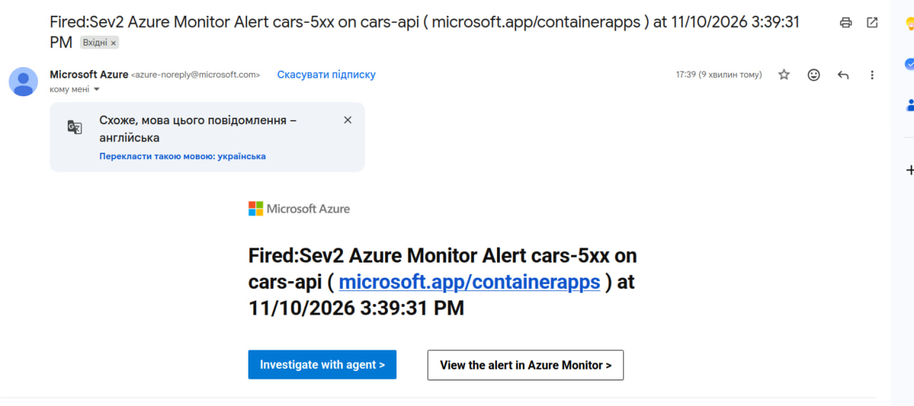
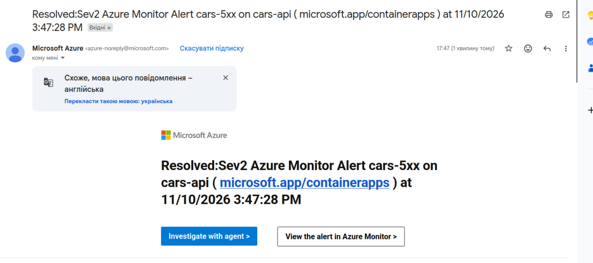

# Звіт з налаштування та тестування сповіщень (Alerts)

## Вибрана умова для сповіщення та обґрунтування
Для системи моніторингу налаштовано правило сповіщень (Metric Alert) у Terraform із такою умовою:
- **Метрика:** досягнення максимальної кількості екземплярів.

## Канал доставки та інфраструктура (Terraform)
Правило та канал доставки повністю описані в Terraform-коді:
- **Action Group:** Налаштовано групу дій (`cars-alerts`), яка підключена до поштової розсилки інженерної команди.
- **Два типи сповіщень:** 
  1. *Alert Activated* — надсилається лист при перевищенні порогу.
  2. *Alert Resolved* — надсилається другий лист, коли навантаження спадає і система повертається до норми.

## Знімки екрана (Screenshots)

### 1. Лист про надмірне навантаження (Alert Activated)

### 2. Лист про повернення системи до норми (Alert Resolved)

### 3. Час між листами.

---

## Аналіз часу реакції та часових затримок

- **Час від початку сталого навантаження до отримання першого листа:** `~4 хвилин 45 секунд`.
- **Чому виникає ця затримка?** 
  1. Спочатку навантаження має зрости і триматися вище порогу мінімум **2 хвилини** (визначено в умовах правила).
  2. Додатково хмарна система моніторингу витрачає час на агрегацію метрик (evaluation period) та генерацію сповіщення через Action Group (близько 2–2.5 хвилини).

## Оцінка прийнятності для реального сервісу
Затримка в ~3.5–4 хвилини є **прийнятною** для попереджувальних/метричних сповіщень про навантаження (наприклад, для планування ресурсів чи аналізу трафіку). 
Проте для критичних інцидентів (повний падіння сервісу або помилки 5xx) такий час реакції **занадто довгий**. У реальних продакшн-системах для критичних збоїв краще використовувати *heartbeat*-моніторинг або алерти за станом доступності (Availability Tests), які реагують протягом 30–60 секунд.