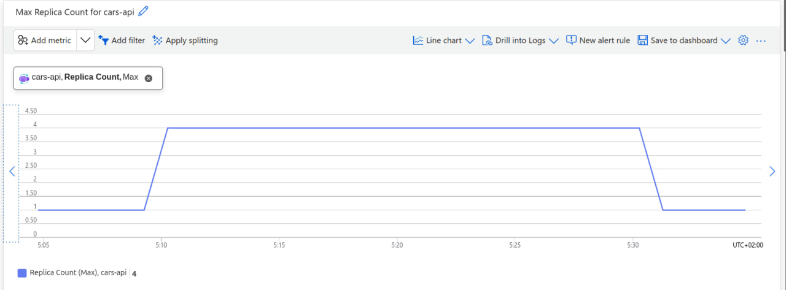
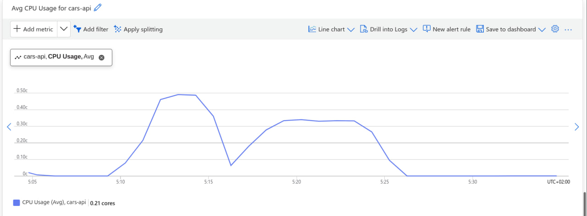
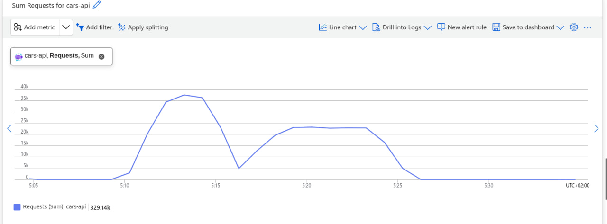
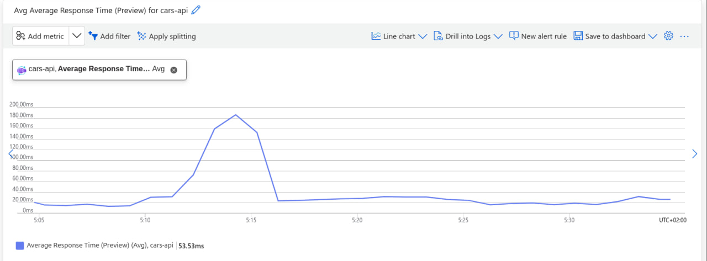
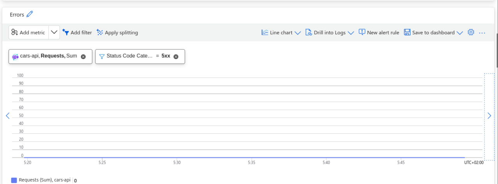

Побудована в хмарі панель моніторингу містить 5 ключових графіків для відстеження стану сервісу:
1. **Кількість екземплярів:** порівняння бажаної та фактичної кількості реплік контейнера.
2. **Завантаження процесора (CPU Utilization):** відсоток використання CPU.
3. **Кількість запитів за хвилину (Requests/min):** інтенсивність вхідного трафіку.
4. **Латентність p95 (Response Time p95):** час відповіді системи для 95% запитів.
5. **Кількість відповідей 5xx (Server Errors):** моніторинг стабільності та відсутності помилок на сервері.
CPU = 85%. Показник у 85% дає достатній «запас міцності» (headroom) для короткочасних піків навантаження. Система не починає створювати нові дорогі контейнери при кожному дрібному коливанні, а реагує лише тоді, коли поточний екземпляр дійсно наближається до вичерпання своїх обчислювальних ресурсів.
## Панель моніторингу автоскейлінгу

### Аналіз поведінки під час навантажувального тесту
#### 1. Чому між перетином порогу CPU і появою нового екземпляра минає час?
Коли навантаження зростає і середнє завантаження процесора перетинає цільовий поріг (наприклад, 60%), новий екземпляр з'являється не миттєво через кілька послідовних етапів:
- **Період оцінки (Evaluation / Polling interval):** система моніторингу не реагує на миттєвий сплеск, а перевіряє метрики протягом певного інтервалу (зазвичай 30–60 секунд), щоб переконатися, що це стійке зростання, а не короткочасний пік.
- **Час ініціалізації інфраструктури (Cold start / Provisioning):** після прийняття рішення про масштабування платформи хмари потрібен час на резервування ресурсів, завантаження контейнерного образу з реєстру (ACR) та запуск застосунку.

#### 2. Чому вилучення екземпляра (Scale-in) відбувається значно пізніше за падіння навантаження?
Після завершення активної фази тесту і спаду трафіку кількість реплік не зменшується миттєво з двох причин:
- **Період стабілізації (Cooldown window):** платформа навмисно витримує паузу після падіння навантаження, щоб запобігти ефекту «хитання» (flapping), якщо трафік раптово знову зросте.
- **Безпечне завершення сесій (Graceful shutdown):** існуючі екземпляри дають змогу завершити поточні активні з'єднання та запити клієнтів перед тим, як остаточно вимкнути контейнер.