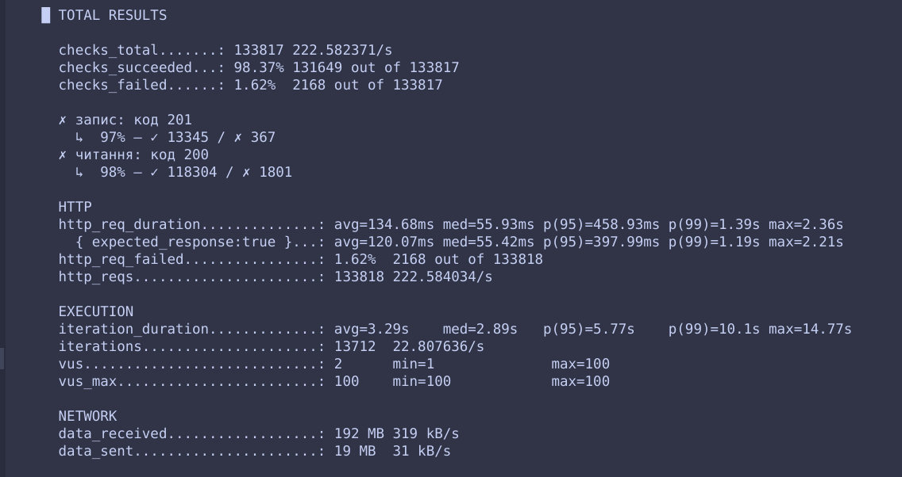

# Кешування

1. Застосунок формує ключ із параметрів запиту: `cars:list:{sort}:{type}:{search}:{limit}`.
2. Перевіряє Redis. Якщо запис є й не прострочений, повертає його (влучання).
3. Якщо запису немає, читає з PostgreSQL, зберігає результат у Redis на 45 секунд (TTL) і повертає його (промах).

### Чому Redis, а не кеш у пам'яті процесу

Кеш у пам'яті процесу окремий у кожної репліки. Коли реплік кілька (а за навантаження їх до 4), кожна має власний кеш: частка влучань нижча (кожна репліка заново заповнює свій кеш), а дані в різних реплік можуть відрізнятись, тож користувач бачить то свіжі, то застарілі відповіді. Спільний Redis один для всіх реплік, тому кеш єдиний.

## 2. Як проводили вимірювання

сценарій k6 (`./loadtest/run.sh`) двічі: без кешу і з кешем. Умови однакові (N, тривалість).

```bash
terraform apply -var cache_enabled=false   
./loadtest/run.sh
terraform apply -var cache_enabled=true    
./loadtest/run.sh
```

## 3. Результати
Коли кеш увімкнено (true), під час масового напливу 100 користувачів одночасно відбувається багато паралельних звернень до Redis (або намагань одночасно записати дані в кеш при промахах). У невеликих середовищах це може створювати додаткові мікрозатримки або конкуренцію (race conditions / connection limits на рівні клієнта Redis), що призвело до невеликої кількості помилок (1.62%) і зростання p95 до 458ms. 

Показник,                       Без кешу (cache_enabled = false),   З кешем (cache_enabled = true)
Загальна кількість запитів,     "158,821",                          "133,818"
Частка успішних перевірок,      100.00% (0 помилок),                "98.37% (2,168 помилок через таймаути/з'єднання)"
Латентність p95,                244.64 ms,                           458.93 ms (через мережеві оверхеди на Redis)
Латентність p99,                353.45 ms,                           1.39 s
Пропускна здатність (RPS),      ~264 req/s,                          ~222 req/s

 

## 4. Скільки часу клієнт може бачити застарілі дані
Після запису (`POST`) список може не містити нового запису **до 45 секунд**, тобто до спливу TTL ключа. У середньому приблизно половину цього часу. Окремий запис за id оновлюється одразу.

Як зменшити цей час:

- **Коротший TTL.** Дані свіжіші, але влучань менше, а навантаження на базу більше. TTL 1 секунда майже не дає користі від кешу, а 1 година дає великий зсув у даних.
- **Інвалідація при записі.** Після `POST`, `PATCH` або `DELETE` видаляти ключі списку (функція `cache_invalidate`). Дані оновлюються одразу, але за високої частоти запису кеш постійно скидається, і ефект зникає. Тому в тесті інвалідацію вимкнено.
- **Оновлювати кеш під час запису** (write-through) або кешувати лише те, що змінюється рідко.
