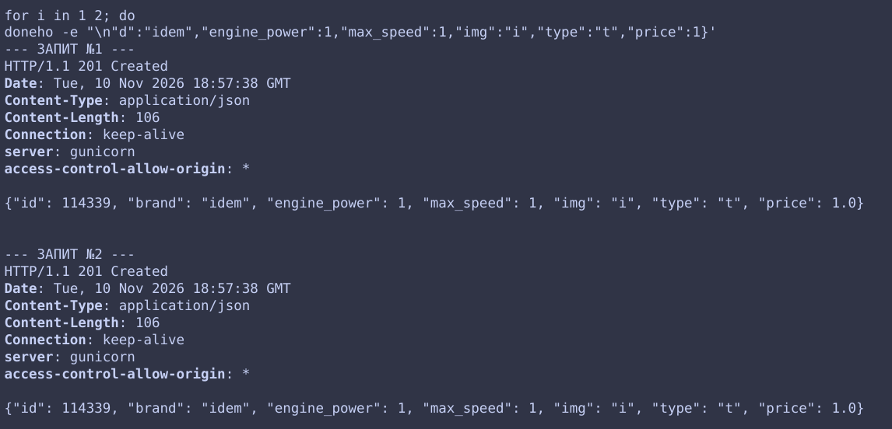

# Ідемпотентність операцій запису
## Проблема яка зникає?
У розподілених системах клієнти часто стикаються з обривами зв'язку. Якщо клієнт надіслав запит на створення машини, але відповідь не дійшла через збій мережі, він повторює запит. Без ідемпотентності це призведе до створення дублікатів у базі даних. 

Заголовок `Idempotency-Key` дозволяє однозначно ідентифікувати запит. Якщо операція з таким ключем уже виконувалася, сервер не створює дублікат, а повертає збережений результат.
Приклад:

## Як це поєднується із Завданням 6?
Завдання 6 використовує асинхронну чергу з гарантією доставки *at-least-once* (повідомлення може бути прочитане воркером більше одного разу). Ідемпотентність на базі Redis (`req:{request_id}`) є ключовим компонентом, який робить цю асинхронну архітектуру безпечною: воркер перевіряє статус у Redis перед записом у PostgreSQL і пропускає дублікати.