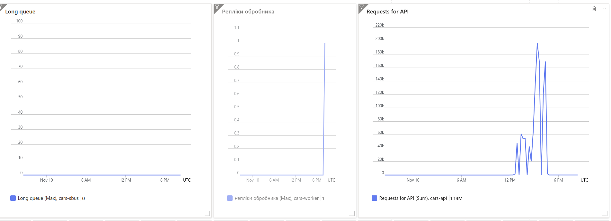

# Асинхронна обробка через чергу (Service bus)

## Плюси
- **Миттєва відповідь:** Замість того, щоб змушувати клієнта чекати на виконання важкої операції запису в базу даних PostgreSQL, API-сервер приймає запит, поміщає його в чергу Azure Service Bus (`car-writes`) і миттєво повертає статус **`202 Accepted`**.
- **Стабільна латентність:** Час відповіді API більше не залежить від навантаження на базу даних чи кількості одночасних записів.
 
## Доставка «щонайменше один раз» (At-least-once delivery)
Брокери повідомлень (такі як Azure Service Bus) гарантують, що жодне повідомлення не буде втрачене. Якщо під час обробки сталася помилка мережі або воркер аварійно завершив роботу до підтвердження (`complete_message`), повідомлення повертається в чергу і доставляється повторно. Це називається доставкою «щонайменше один раз».

## Що буде при повторній обробці повідомлення?
Оскільки повідомлення може бути доставлене повторно через особливості брокера, воркер використовує перевірку ідемпотентності через Redis (Завдання 7). Це гарантує, що навіть при багаторазовій доставці одного й того ж повідомлення в базу даних буде записано лише один унікальний об'єкт.